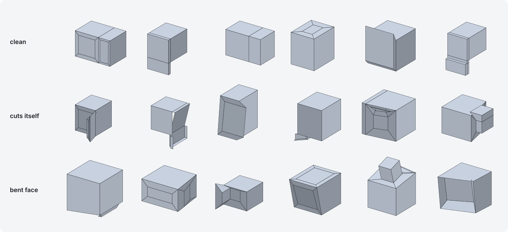

# From Thin Air

A 3D modeling dataset built from thin air.

Every shape in it comes with the modeling steps that built it. Nobody modeled anything by hand.


That is one example from the dataset. It starts as a cube. Five moves later it is a new shape, and the five moves are stored with it.

## The idea

A network that turns a 3D shape into modeling steps would be useful. Its output would be a history you can edit, not a frozen mesh. Training one needs many shapes paired with the steps that made them, and that data does not exist for polygon meshes.

So this project makes the data backward.

1. Pick some modeling moves at random.
2. Run them on a cube.
3. Keep the moves and the mesh they made.

The moves are known before the shape exists, so the pair is always correct. Running the stored moves again rebuilds the stored mesh exactly, so anyone can check any example.

## What the shapes look like

These are 48 shapes from the first dataset, picked at random from the ones that pass every quality check.


They are lumpy blocks. Random moves do not make chairs. Getting to real objects is the next part of the plan, and it is not built yet.

## What is here

| File | What it does |
| --- | --- |
| `executor.py` | Runs modeling moves on a cube and records the mesh after every move. It uses Blender's `bmesh` with no window. |
| `shard.py` | Reads and writes the dataset files. A shard is one `.npz` file that holds many examples as plain arrays. |
| `evals.py` | Checks a mesh for flaws, and measures how far apart two shapes are. |
| `stats.py` | Prints what a dataset file holds. |
| `render.py` | Draws the steps of a build as images. |
| `index.html` | A browser player that steps through one build. |
| `data/round0.npz` | The first dataset: 10,000 examples. |
| `journal/` | The record of every step so far, with images, numbers and timings. |

## The first dataset

`data/round0.npz` holds 10,000 examples. Each one is 1 to 5 moves from a cube.

There are three moves so far, and each one acts on a single face.

| Move | What it does |
| --- | --- |
| extrude | Pushes the face out and adds side walls. |
| inset | Adds a smaller face inside, with a ring of faces around it. |
| slide | Moves the face in or out. |

Some numbers, measured on an Apple M2 Max using one process:

| Measure | Value |
| --- | --- |
| Examples | 10,000, every one a different mesh |
| Moves in total | 36,303 |
| File size | 1.08 MB |
| Time to generate | 4.05 seconds |
| Examples that rebuild exactly when replayed | 10,000 |

## Checking the shapes

Random moves often make bad geometry. `evals.py` looks for it.



| Check | Shapes, of 10,000 |
| --- | --- |
| Sealed solid with positive volume | 10,000 |
| Passes every check | 6,533 |
| Cuts through itself | 148 |
| Has a bent face | 1,962 |
| Has a thin face | 1,294 |

The more random moves a shape has, the less likely it is to pass. One-move shapes pass every time. Five-move shapes pass 43% of the time.

## Running it

You need Blender 5.1 and a Python with NumPy.

Make a dataset. This writes the file, reads it back, and replays every move list as a check.

```
blender -b --factory-startup --python executor.py -- --n 10000 --seed 0 --out data/round0.npz
```

Run the checks on it.

```
python evals.py data/round0.npz
```

Make the images on this page.

```
python readme_images.py
```

## The journal

Every step of this project has a page in `journal/`. Each page says what the step was for, what was done, what was seen, and what comes next. Clone the repo and open `journal/index.html` in a browser to read it.

## Where this stands

- The dataset, the file format and the first checks work.
- No network has been trained on the data yet.
- The three moves are a trial set. They will change.
- The plan for harder shapes is a loop. A 3D generator supplies target shapes, a small network tries to build them, and every attempt becomes a new example. None of that is built.

## Related work

This project builds on ideas from other people's work. These are the closest ones found so far.

- [PLAD](https://arxiv.org/abs/2011.13045): self-training for shape programs.
- [PLLM](https://arxiv.org/abs/2602.12561): a self-training loop for CAD programs.
- [Differentiable Operation Graph](https://arxiv.org/abs/2508.17645): recovering editable histories for polygon models.
