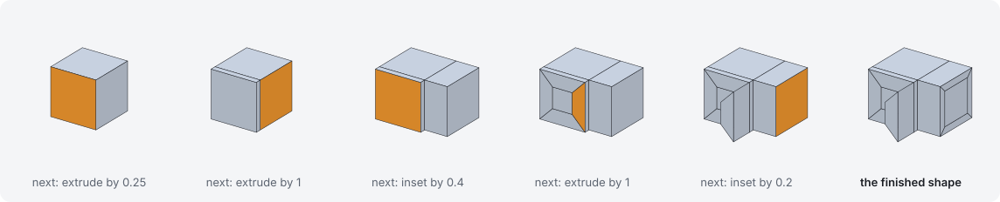
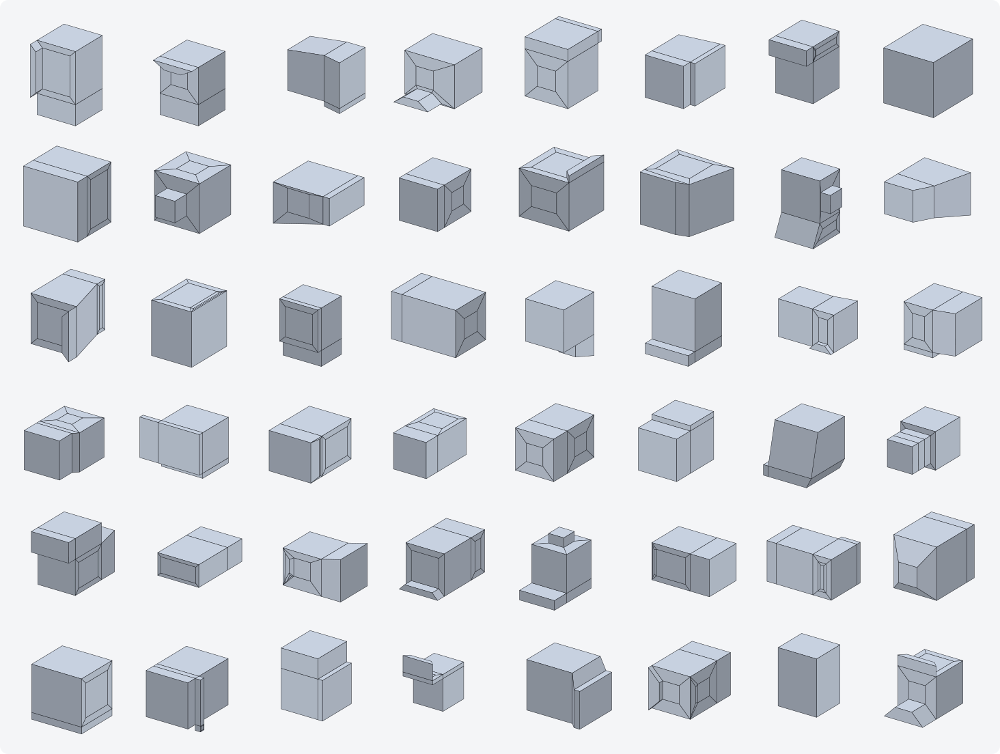

# From Thin Air

A 3D modeling dataset built from thin air.

Every shape in this dataset comes with the complete modeling history that built it, and every history is verified. Replay the moves and you get the exact same mesh, every time. A script made all of it, with no scraped data. The first 10,000 examples took four seconds to generate on a laptop, and they fit in about 1 MB.



The image above is one example. It starts as a cube and changes one face at a time over five moves. The dataset stores those five moves along with the mesh after each one.

## The idea

A network that turns a 3D shape into modeling steps would give an artist a history to edit instead of a fixed mesh. Training such a network takes many shapes paired with the steps that made them, and for polygon meshes that data does not exist.

This project generates the data by working backward. Instead of starting from a finished shape and guessing how it was built, it starts from the moves:

1. Pick some modeling moves at random.
2. Run them on a cube.
3. Keep the moves and the mesh they made.

Because the mesh is made from the moves, every pair is correct by construction. It is also easy to verify, since running the stored moves again rebuilds the stored mesh exactly.

## What the shapes look like

The 48 shapes below were picked at random from the ones in the first dataset that pass every quality check.



They look like lumpy blocks rather than real objects, which is what random moves produce. Getting from blocks to recognizable objects is the next part of the plan, and none of it is built yet.

## What is here

| File | What it does |
| --- | --- |
| `executor.py` | Runs modeling moves on a cube and records the mesh after every move. It uses Blender's `bmesh` with no window. |
| `shard.py` | Reads and writes the dataset files. A shard is one `.npz` file that holds many examples as plain arrays. |
| `evals.py` | Checks a mesh for flaws, and measures how far apart two shapes are. |
| `stats.py` | Prints what a dataset file holds. |
| `render.py` | Draws the steps of a build as images. |
| `index.html` | A browser player that steps through one build. |
| `data/round0.npz` | The first dataset: 10,000 examples. |
| `journal/` | The record of every step so far, with images, numbers and timings. |

## The first dataset

`data/round0.npz` holds 10,000 examples, each between one and five moves away from a cube. The move set is small for now. It has three moves, and each one acts on a single face.

| Move | What it does |
| --- | --- |
| extrude | Pushes the face out and adds side walls. |
| inset | Adds a smaller face inside, with a ring of faces around it. |
| slide | Moves the face in or out. |

The numbers below were measured on an Apple M2 Max using one process.

| Measure | Value |
| --- | --- |
| Examples | 10,000, every one a different mesh |
| Moves in total | 36,303 |
| File size | 1.08 MB |
| Time to generate | 4.05 seconds |
| Examples that rebuild exactly when replayed | 10,000 |

## Checking the shapes

Random moves often produce bad geometry, and `evals.py` checks every shape for it. The image below shows a row of shapes that pass, a row of shapes that cut through themselves, and a row of shapes with a bent face.


| Check | Shapes, of 10,000 |
| --- | --- |
| Sealed solid with positive volume | 10,000 |
| Passes every check | 6,533 |
| Cuts through itself | 148 |
| Has a bent face | 1,962 |
| Has a thin face | 1,294 |

Longer builds fail more often. Every one-move shape passes every check, while only 43% of five-move shapes do.

## Running it

You need Blender 5.1 and a Python with NumPy.

The first command makes a dataset. It writes the file, reads it back, and replays every move list as a check.

```
blender -b --factory-startup --python executor.py -- --n 10000 --seed 0 --out data/round0.npz
```

The second runs the checks on that file.

```
python evals.py data/round0.npz
```

The third remakes the images on this page.

```
python readme_images.py
```

## The journal

Every step of this project has a page in `journal/`. Each page records what the step was for, what was done, what was seen, and what comes next. To read it, clone the repo and open `journal/index.html` in a browser.

## Where this stands

The dataset, the file format and the first checks all work. Training a network on the data has not started yet, and the three moves are a trial set that will change.

The plan for harder shapes is a loop. A 3D generator supplies target shapes, a small network tries to build them, and every attempt becomes a new example. None of that loop is built.

## Related work

This project builds on other people's ideas. These are the closest ones found so far.

- [PLAD](https://arxiv.org/abs/2011.13045): self-training for shape programs.
- [PLLM](https://arxiv.org/abs/2602.12561): a self-training loop for CAD programs.
- [Differentiable Operation Graph](https://arxiv.org/abs/2508.17645): recovering editable histories for polygon models.
