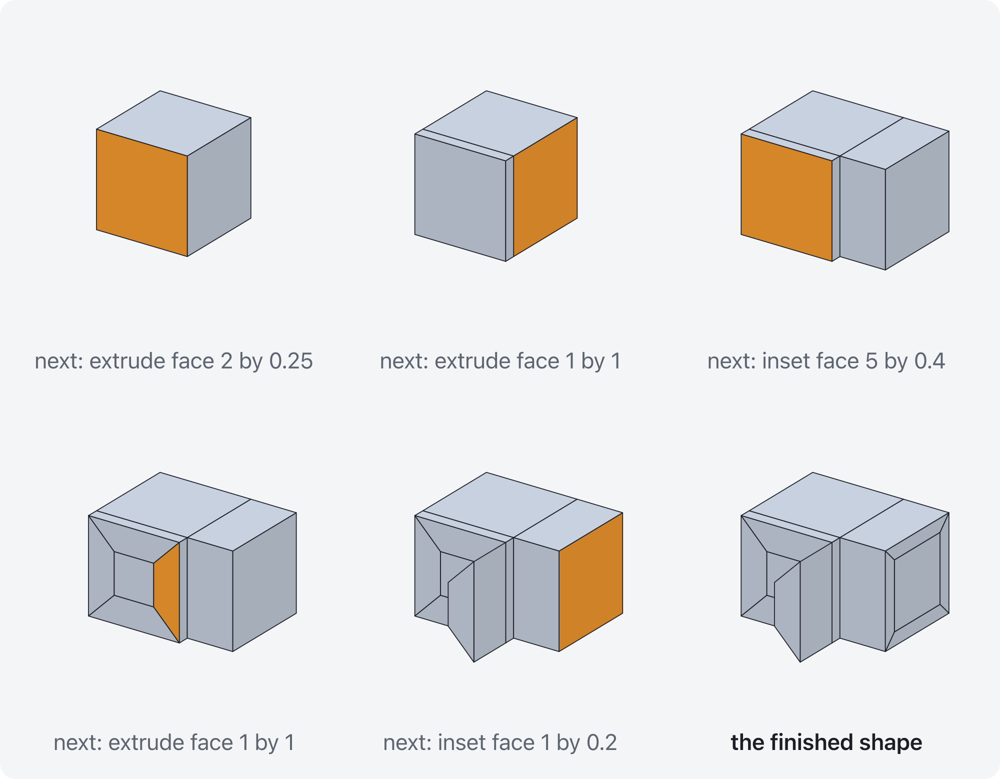
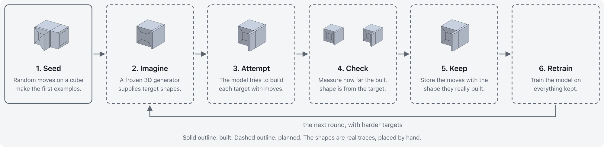
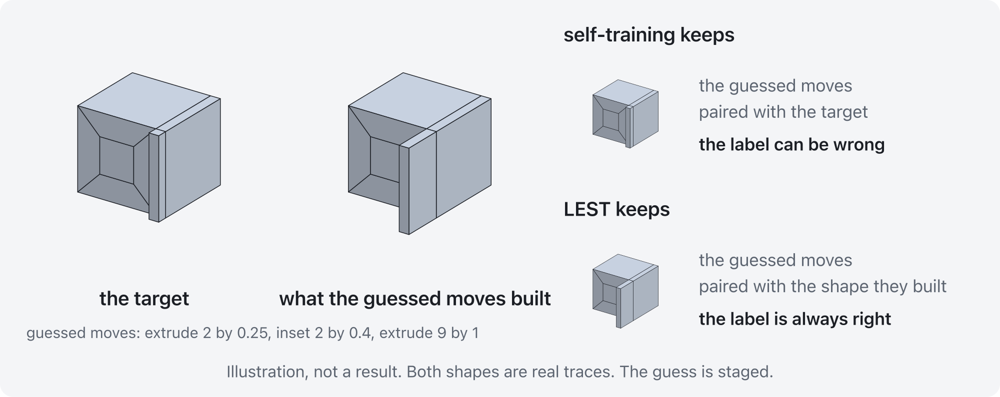
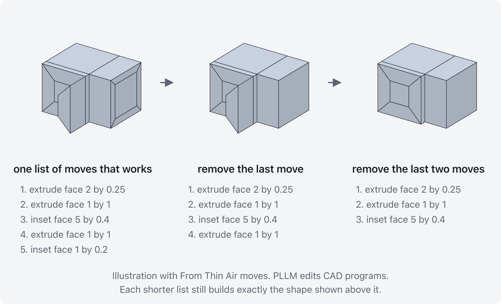

# PLAD and PLLM together

Status: draft, not published. Platform: LinkedIn.

---

I've been working on a way to make training data for polygon modeling. Two papers already cover the core of the method, PLAD and PLLM, and this post is about what I learned from them.

## What I'm trying to build

I want a small model that can look at a 3D shape and work out the steps an artist would use to build it, like extrude this face or inset that one. Almost no data like that exists. There are plenty of meshes out there, but they don't come with the history of how they were made.

## My plan

I work backward. I pick the steps first and then run them, which means I already know how the shape was built.

From there the plan is a loop.

1. **Seed.** Random moves on a cube make the first examples.
2. **Imagine.** A frozen 3D generator supplies target shapes.
3. **Attempt.** The model tries to build each target with modeling moves.
4. **Check.** Measure how far the built shape is from the target.
5. **Keep.** Store the moves with the shape they actually built. A miss is still a correct example.
6. **Retrain.** Train the model on everything kept, then go around again with harder targets.

Only step 1 is built. The rest is the plan.

## PLAD, 2022

PLAD is a paper from Kenny Jones, Homer Walke and Daniel Ritchie at Brown. It has the same keep step and calls it latent execution self-training, or LEST.

The paper compares three ways to make a training pair.

- **Self-training.** The model guesses a program for a real shape. The guess is kept as the label, even though it may be wrong.
- **Wake-sleep.** A generative model samples programs, and their outputs stand in for real shapes.
- **LEST.** The model guesses a program for a real shape. The program is run, and it is paired with the shape it actually made. The label can't be wrong.

What they found:

- LEST reached the same quality as reinforcement learning about 32 times faster on one of their tests.
- Their best results came from mixing LEST with plain self-training.
- One method keeps the labels correct, and the other keeps the data close to real shapes.

I would not have guessed that mix, and it changes how I think about my own loop.

## PLLM, 2026

PLLM is from the same group this year, with Yuanbo Li and a team from Toyota Research Institute. It runs the same loop on a large language model that writes CAD programs.

- It starts from a pretrained model and a set of unlabeled shapes.
- Each round it samples candidate programs and keeps the ones whose results match well.
- It edits the kept programs, adding or removing steps, to make new examples that are still correct by construction.

That last part is close to what I was planning, where the model's own shapes become seeds for the next round.

## Where this leaves me

I think this leaves me in a good spot. My instincts pointed the same way as people who have done this carefully, and now I can build on their work instead of guessing.

The open problem for me is structure.

- The PLAD conclusion says that if a program is going to be edited, good structure matters as much as getting the shape right.
- Nothing in these methods really teaches what good structure looks like.
- PLLM prefers the shorter program when two are equally good, which helps a little.

For polygon modeling I want a history an artist would actually want to work with, and that is what I'm going to work on next.

Both papers are worth reading if you work near 3D or program synthesis. I'll share what happens when I train my first model.

PLAD: https://arxiv.org/abs/2011.13045

PLLM: https://arxiv.org/abs/2602.12561
